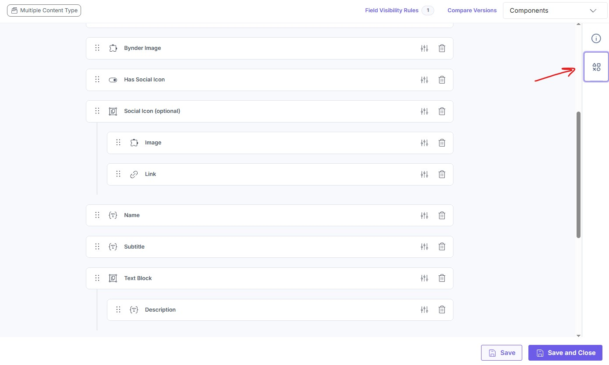
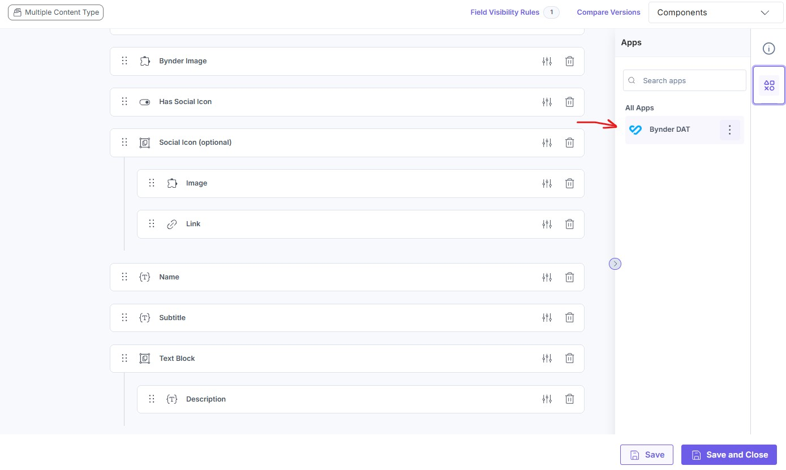
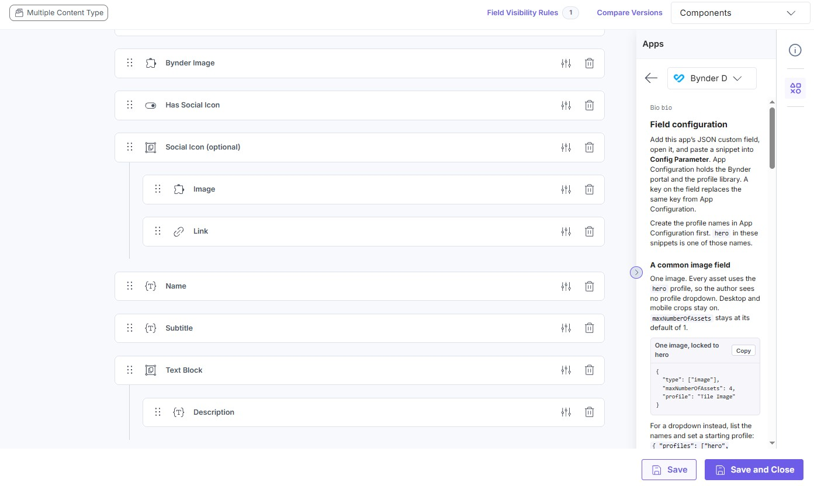

# Bynder Image Settings

Written by **Anthony Smith**. Owned by **Capgemini**.

# OVERVIEW

Contentstack custom field for Bynder Universal Compact View. An author picks an asset and a focal point. The field saves one JSON object: the chosen render profile as a snapshot, plus each asset. The website reads that object from the entry and builds Bynder DAT URLs from it.

Use it when image crops should be fixed by a profile (aspect, format, quality) while authors only place the focal point. **Fill** is the only transform. The site chooses the widths. Delivery caps each request so neither side passes `maxDimension` (2000 unless App Configuration sets another limit).

The official Bynder Marketplace app is not required, and this field does not read a sibling Bynder field. App Configuration is not available to the website, so each entry stores the profile it used.

A hosted build is already available at [https://asmith-lyonscg.github.io/contentstack-bynder-app](https://asmith-lyonscg.github.io/contentstack-bynder-app) (no trailing slash). [INSTALLATION](#installation) connects a stack to it. [APP SETTINGS](#app-settings) is the portal and the profile library. [CUSTOM FIELD CONFIGS](#custom-field-configs) is the per-field Config Parameter. [DELIVERY](#delivery) is how a site renders the saved object.

# INSTALLATION

Create a private app in Developer Hub and point it at this app. The sections below are the Developer Hub settings. After the app is installed, set the portal and profiles in [APP SETTINGS](#app-settings), then add the JSON field and an optional [CUSTOM FIELD CONFIGS](#custom-field-configs) parameter.

1. Open **Developer Hub** and create a Standard / private app, or open an existing one.
2. Open **Settings → Basic Information** and set:

   | Field | Value |
   |---|---|
   | Name | `Bynder + Focal Point` |
   | Description | Companion custom field for Bynder fields which lets authors set a focal point, and live-previews the transformed image. |
3. Open **Hosting → Custom Hosting**.
4. Set **App URL** to the hosted build, with no trailing slash:

   `https://asmith-lyonscg.github.io/contentstack-bynder-app`

   A local or self-hosted URL is covered under [Run it locally](#run-it-locally) and [Host on GitHub Pages](#host-on-github-pages). The UI locations stay the same.
5. Add **UI Locations**:

   | Location | Name (suggestion) | Path | Data type |
   |---|---|---|---|
   | Custom Field | Bynder Asset Settings | `/custom-field` | **JSON** |
   | App Configuration | (default) | `/app-configuration` | — |
   | Content Type Sidebar | Bynder field setup | `/content-type-sidebar` | — |

6. Install the app on the stack.
7. Open **App Configuration** and enter the Bynder portal host, then use Contentstack’s **Save**. See [APP SETTINGS](#app-settings).
8. On a content type, add this app’s JSON custom field. Paste a Config Parameter on the field when that field should differ from the app defaults. See [CUSTOM FIELD CONFIGS](#custom-field-configs).

### Open the field guide

The Content Type Sidebar is the field-config guide (examples and the key table). It opens from the content type editor. See [Content Type Sidebar Location](https://www.contentstack.com/docs/developer-hub/content-type-sidebar-location).

1. Open the content type. On the right edge, select the **Apps** icon.

   

2. In **Apps**, select this app.

   

3. The field guide opens in that panel. The same material is in [CUSTOM FIELD CONFIGS](#custom-field-configs).

   

Authors sign into Bynder inside Compact View. The field stores one JSON object (`v`, `profile`, `assets`). The Delivery API returns that object on the field’s UID. See [DELIVERY](#delivery).

### Run it locally

Use this while changing the app code. Do not point a production Contentstack app at `localhost` for real authors.

Node.js **22+**, this repo, and Developer Hub access.

```bash
npm install
npm run dev
```

The app is usually at `http://localhost:3000`. In **Hosting → Custom Hosting**, set **App URL** to that URL with no trailing slash. Keep the UI location paths from the table above. Reload the entry editor. The iframe runs this build.

```bash
npm test
npm run typecheck
npm run build
```

`npm run build` writes `dist/` (`404.html`, `.nojekyll`, and HTML shells for `/custom-field`, `/app-configuration`, `/content-type-sidebar`, and `/picker`).

```
samples/payload/                 Sample payloads (saved field JSON)
samples/react-handler/           Sample React handler
samples/html-output/             Sample HTML output
src/locations/CustomField/        Custom Field UI
src/locations/AppConfig/          Portal URL, max dimension, render profiles
src/locations/ContentTypeSidebar/ Field Config Parameter guide
src/components/                   Compact picker, crop editor, transform form
src/lib/bynder/                   Parse Compact View JSON and compose DAT URLs
src/delivery/                     Website helper
```

Built from the [Marketplace App Boilerplate](https://github.com/contentstack/marketplace-app-boilerplate) (Vite, React, `@contentstack/app-sdk` ^2.4, `@bynder/compact-view`).

### Host on GitHub Pages

Use this for your own public App URL. Push the repo, then **Settings → Pages → Build and deployment → Source: GitHub Actions**. A push to `main` runs `.github/workflows/pages.yml` and publishes `dist`.

The project site is `https://<user>.github.io/<repo>`. This repo is [https://asmith-lyonscg.github.io/contentstack-bynder-app](https://asmith-lyonscg.github.io/contentstack-bynder-app). Set that as **App URL** with no trailing slash. Contentstack then loads paths such as `https://asmith-lyonscg.github.io/contentstack-bynder-app/custom-field`.

To preview the Pages base locally:

```bash
npm run build:pages
```

```powershell
$env:VITE_BASE_PATH="/contentstack-bynder-app/"; npm run preview
```

Open `/contentstack-bynder-app/`. A custom domain can use base `/` again (leave `VITE_BASE_PATH` unset). GitHub Pages can be iframed by Contentstack. Bitbucket `*.bitbucket.io` sends `X-Frame-Options: DENY` and cannot.

# APP SETTINGS

Open **App Configuration** after the app is installed on the stack. Contentstack’s **Save** stores it. The form sends the configuration as you edit, so there is no second save button inside the form. Per-field overrides, including locking a profile or limiting file types, are [CUSTOM FIELD CONFIGS](#custom-field-configs). A field key replaces the same key from here.

### Bynder portal

**Bynder portal URL** is the portal host, with no `https://`. Example: `acme.getbynder.com`. Saved as `bynderPortalUrl`. Required for Compact View. A field Config Parameter can set the same key for that field only.

### Bynder max dimension

**Bynder max dimension** is `maxDimension` (default `2000`). Bynder returns the original file when a DAT transform is larger than the account limit on either side. Set this to that account limit. The site chooses the request widths. Delivery shrinks any step, keeping its aspect ratio, so neither side passes `maxDimension`. The value is written onto a profile snapshot only when it is not 2000.

### Render profiles

**Render profiles** is a JSON object of named profiles. There is no built-in profile. With none, each asset keeps the aspect ratio of its original pixels (`origWidth` / `origHeight`, reduced, so `4000×3000` becomes `4:3`).

```json
{
  "hero": {
    "desktop": "16:9",
    "mobile": "4:3",
    "quality": 80,
    "format": "webp"
  },
  "largeHero": {
    "desktop": "21:9",
    "mobile": "4:5"
  }
}
```

- Every profile needs `desktop` and `mobile` aspect ratios (`"W:H"`).
- `quality` (1–100) defaults to `80`. `format` (`webp`, `avif`, `jpg`, `png`) defaults to `webp`.
- Names must be unique, start with a letter, and use letters, numbers, `_`, or `-`. The name `custom` is reserved.
- The editor validates as you type and will not save invalid JSON, a duplicate name, or an invalid profile.

Authors do not type a width, height, aspect, format, or quality. The profile locks aspect, format, and quality. Authors set the focal point. The entry stores `profile.id` plus `profile.settings`, because the website cannot read App Configuration. Editing a profile here updates that snapshot the next time an entry that uses it is opened. The field then shows **Unsaved changes** until the entry is saved. If a profile is removed entirely, an entry that already saved it keeps the old snapshot and shows a warning until the author picks another profile.

# CUSTOM FIELD CONFIGS

Each JSON custom field has its own **Config Parameter** (the field’s advanced settings). It wins over [APP SETTINGS](#app-settings) and over `compactViewConfig.assetTypes`. The Content Type Sidebar shows two examples and a short key table. This section is the full reference.

Add one JSON custom field. A Group around it is optional.

### Examples

**Locked to one profile.** Authors do not get a dropdown. Every asset uses it.

```json
{ "profile": "hero" }
```

**A common image field.** Up to four images. The dropdown starts on `Tile Image`.

```json
{
  "type": ["image"],
  "maxNumberOfAssets": 4,
  "profiles": ["Tile Image", "Hero Large"],
  "defaultProfile": "Tile Image"
}
```

**Hero banner: two app profiles, up to 3 assets**

```json
{
  "desktopMobileMode": true,
  "maxNumberOfAssets": 3,
  "profiles": ["hero", "largeHero"],
  "defaultProfile": "hero"
}
```

**Images only**

```json
{ "type": ["image"], "desktopMobileMode": true }
```

**Video only.** One file, playback options, no mobile crop.

```json
{
  "type": ["video"],
  "desktopMobileMode": false,
  "video": { "autoplay": false, "muted": true, "controls": true, "loop": false }
}
```

**A profile defined on this field**, offered next to an App Configuration profile. **Customize** (a dragged ratio, saved as `profile.id` `"custom"`) is included.

```json
{
  "fieldProfiles": {
    "banner": { "desktop": "21:9", "mobile": "4:3" }
  },
  "profiles": ["banner", "hero"],
  "allowCustomAspect": true
}
```

**Extra author fields**

```json
{
  "type": ["image", "video"],
  "desktopMobileMode": true,
  "additionalFields": [
    { "property": "uniqueId", "type": "boolean", "label": "Unique ID" },
    { "property": "caption", "type": "string", "label": "Caption" },
    { "property": "rank", "type": "number", "label": "Rank" }
  ]
}
```

Author values save on each asset under `additional`.

**PDF / documents**

```json
{ "type": ["pdf"], "desktopMobileMode": false, "maxNumberOfAssets": 1 }
```

Documents save identity plus two public file links. No crop, DAT, alt, or desktop/mobile pair. `url` opens the file. `downloadUrl` is the same URL with Bynder’s `download=true`. The authoring list does not store a thumbnail. For an `/asset/{id}/{file}.pdf` URL it requests `/asset/{id}/thumbnail/thul-{file}` while the field is open, and shows a document icon if that image fails. See [DELIVERY](#delivery) for the saved object.

**Images and videos, metadata stripped so a large list can stay under 10KB**

```json
{
  "type": ["image", "video"],
  "desktopMobileMode": true,
  "suppressMetadata": true,
  "maxNumberOfAssets": 5
}
```

**One crop for every viewport, one profile**

```json
{
  "desktopMobileMode": false,
  "maxNumberOfAssets": 1,
  "profiles": ["card"]
}
```

**Images only, Compact View options passed through**

```json
{
  "type": ["image"],
  "desktopMobileMode": false,
  "maxNumberOfAssets": 1,
  "compactViewConfig": { "hideLimitedUse": true }
}
```

`"profile": "hero"` locks the field. Omit `profile` and the **Render profile** dropdown stays, including after a profile is selected. `profiles` limits that dropdown. With no list, the dropdown offers every App Configuration profile and every `fieldProfiles` name. Unknown names are ignored. `defaultProfile` is the starting profile and makes a profile required. With neither `profile` nor `defaultProfile`, new entries keep the original aspect ratio, and the dropdown also offers **Original aspect ratio**.

`fieldProfiles` uses the same shape as App Configuration `profiles`. A matching name replaces the app profile on this field only. Do not name a profile `custom`.

`type` is `"image"`, `"video"`, and/or `"pdf"`. Omit it and the field allows images and videos. `"desktopMobileMode": false` turns off the desktop/mobile split and uses the profile’s desktop values. `"suppressMetadata": true` stores `id`, asset `type`, and `transformBaseUrl`, plus crop fields, alt, video playback, and `additional`.

Until an asset is chosen, the field shows **+ Choose Asset(s)**. A selected row uses **Change Asset(s)**. **Add Asset(s)** stays under the list until `maxNumberOfAssets` is reached. Closing Compact View without confirming leaves the current assets in place. A newly added asset uses the same file for desktop and mobile until the author picks a different mobile file. Only an image may have a separate mobile file.

`compactViewConfig` passes [Universal Compact View](https://developers.bynder.com/universal-compact-view) props through. `assetTypes` there applies only when `type` is omitted. This app does not set `assetFilter.predefinedAssetType` by default: Bynder hides search and filters when `assetFilter` is present unless `showToolbar` is true. `custom_settings.compact_view_options` is still accepted as an alias of `compactViewConfig`.

### Keys

Field **Config Parameter** unless the row says App Config. A field key replaces the same key from [APP SETTINGS](#app-settings).

| Key | Type | Default | Alias | Description |
|---|---|---|---|------|
| `bynderPortalUrl` | `string` | required | | Portal host. Field config overrides App Configuration. Example: `"acme.getbynder.com"` |
| `maxDimension` (App Config) | `number` | `2000` | | Bynder’s limit on either side of a transformed image. The site chooses the widths, and delivery shrinks any step that would pass this. Example: `4000` |
| `profiles` (App Config) | `object` | none | | Named render profiles. See [APP SETTINGS](#app-settings). |
| `profile` (field) | `string` | none | | Lock this field to one profile. No dropdown. Example: `"hero"` |
| `fieldProfiles` (field) | `object` | none | | Profiles defined on this field, same shape as App Config `profiles`. Offered with the App Config profiles unless `profiles` lists a smaller set. A matching name replaces the App Config profile on this field. Example: `{ "banner": { "desktop": "21:9", "mobile": "4:3" } }` |
| `profiles` (field) | `string[]` or comma-separated `string` | every App Config profile and every `fieldProfiles` name | | Profiles this field allows, in dropdown order. Names may be App Config profiles or `fieldProfiles` keys. Ignored when `profile` names a real profile. Example: `["banner","hero"]` |
| `defaultProfile` | `string` | none (original aspect ratio) | | Profile for new entries, and for entries whose saved profile this field no longer allows. Setting it makes a profile required. Ignored when `profile` is set. Example: `"hero"` |
| `allowCustomAspect` (field) | `boolean` | `false` | | Offer **Customize**, the dragged aspect ratio. Off unless this field sets it. Example: `true` |
| `type` | `("image" \| "video" \| "pdf")[]` | images and videos | | Files Compact View can select. Field config wins over App Configuration and over `compactViewConfig.assetTypes`. Example: `["image", "video"]` |
| `desktopMobileMode` | `boolean` | `true` | | Dual desktop/mobile crops. `false` = one crop per asset; the UI never says desktop or mobile. Example: `false` |
| `suppressMetadata` | `boolean` | `false` | | Drop `name` and `webImage` from the saved JSON. Keeps `id`, `type`, `transformBaseUrl`, crop fields, and alt text. Use this when an entry will not save because the JSON field is over 10KB. Example: `true` |
| `maxNumberOfAssets` | `number` | `1` | `advanced.max_limit` | Cap on selected assets. `1` is Single Select. Values above 1 use Multi Select. Example: `3` |
| `compactLanguage` | `string` | `en_US` | | Compact View locale. Example: `"en_US"` |
| `video` | `object` | controls on; autoplay, mute, and loop off | `videoAutoplay`, `videoMuted`, `videoControls`, `videoLoop` | Default checked state for Autoplay, Mute, Controls, and Loop. Those four checkboxes always show. Saved on the asset as `video`. Example: `{ "autoplay": false, "muted": true, "controls": true, "loop": false }` |
| `additionalFields` | `additionalField[]` | none | | Extra author inputs. Each item is `{ "property", "type", "label" }` with `type` `"string"`, `"number"`, or `"boolean"`. Values save under `additional`. An invalid list replaces the custom field with a red error. |
| `compactViewConfig` | `object` | images and videos | `custom_settings.compact_view_options` | [Universal Compact View](https://developers.bynder.com/universal-compact-view) props we pass through. Portal URL, callbacks, and `mode` are not taken from here. |
| `custom_settings.dat_settings` | `object` | omitted | | Marketplace DAT presets. `default` becomes Compact View `defaultImageDerivativeName`. |
| `advanced.max_limit` | `number` | `1` | | Same as `maxNumberOfAssets`. Example: `4` |

### In the entry editor

DAT is used when the selected asset has `transformBaseUrl`. Compact View selects the asset, not a derivative file. Videos never get DAT. With no `transformBaseUrl`, the entry keeps `webImage` and the site uses CSS `object-fit` / `object-position` from `focalPoint`.

The list shows desktop and mobile thumbs unless `desktopMobileMode` is false. Each image thumb uses that viewport’s profile aspect. Documents use a letter-shaped frame. Crop and focal controls appear only while an image thumbnail is selected. Videos open playback settings. Documents stay in the list and are not selectable.

The **Render profile** dropdown is hidden when `"profile"` is set. Otherwise it stays visible after a selection. **Original aspect ratio** is a choice when the field sets no `defaultProfile`. **Customize** is a choice only when `allowCustomAspect` is true. It starts each viewport at that file’s own ratio. Dragging the right edge of the preview sets a new ratio. The choice applies to every asset in the field.

The crop header shows **Profile:** and the assigned name, or **Original aspect ratio**, then **Aspect Ratio:** for the viewport being edited. The link between the desktop and mobile thumbnails means those viewports are the same asset with the same crop. A profile with different desktop and mobile aspects shows no link. **Match desktop** and **Match mobile** copy the focal point across and hide once the two already match. **Reset center** hides at 50%, 50%. A different mobile asset hides the link and both match actions. Picking the desktop file again for mobile, with the same crop and alt text, removes `mobile` from the saved JSON.

Hovering a thumbnail shows the aspect ratio and file type, for example `16:9 · WebP`, or `16:9 · JPG · 2.1 MB` when the file has no transform URL. **Edit** opens the crop editor. Copy URL composes the active tab’s largest default srcset step with the same code the site uses. Click or drag the red dot to set the focal point.

On load, the field normalizes the stored value the same way a save does and compares the result, ignoring key order. When nothing differs, opening the entry leaves it clean. When something differs, the field writes the updated value and shows **Unsaved changes** until the entry is saved. That happens when the entry’s profile changed in App Configuration, the saved profile left this field’s `profiles` list, `desktopMobileMode` turned off, `suppressMetadata` turned on, a new boolean `additionalFields` item added its `false` default, or original pixel size was filled in because `origWidth` and `origHeight` were missing.

# DELIVERY

Read the custom field from the entry. Its UID is the one on the content type. The Delivery API returns the object below (`v`, `profile`, `assets`). When a client gives you a string, parse it once.

The entry stores no DAT URLs. It stores the profile snapshot and each asset’s focal point and Fill. The site composes every URL. **Fill** is `io=transform:fill,width:W,height:H&focuspoint=x,y`. A missing focal point is the center, `0.5,0.5`.

`profile` is `{ id, settings }`. `id` is the profile name. `settings.desktop` and `settings.mobile` are aspect-ratio strings. `settings` also has `quality` and `format`. **Customize** saves `id: "custom"`. With no profile, `id`, `desktop`, and `mobile` are omitted and the site uses `origWidth` / `origHeight`. `maxDimension` is on the snapshot only when it is not 2000.

Each asset has `id`, `name`, `type`, `transformBaseUrl`, `alt`, `origWidth`, `origHeight`, and `operation` (`"fill"`). `focalPoint` is saved only when it is not `0.5`, `0.5`. Those pixels are the Bynder original. A video also stores `video` (`autoplay`, `muted`, `controls`, `loop`) and no focal point. Play `webImage.url` when it is present and leave that URL unchanged. A document stores `url` (view) and `downloadUrl` (download). `webImage` is saved only when an image has no `transformBaseUrl`. Configured `additionalFields` values are on `additional`.

Mobile that still matches desktop is omitted. A mobile with its own focal point, or a different file, is `assets[n].mobile`. A different file also has its own `id`, `transformBaseUrl`, `origWidth`, `origHeight`, and `alt`.

```json
{
  "v": 2,
  "profile": {
    "id": "hero",
    "settings": {
      "desktop": "16:9",
      "mobile": "4:3",
      "quality": 80,
      "format": "webp"
    }
  },
  "assets": [
    {
      "id": "2DC52E62-5FB1-4938-BF689857EF9B51E2",
      "name": "Earth",
      "type": "IMAGE",
      "alt": "The Earth from space",
      "transformBaseUrl": "https://portal.bynder.com/transform/earth.jpg",
      "origWidth": 4000,
      "origHeight": 2667,
      "focalPoint": { "x": 0.35, "y": 0.42 },
      "operation": "fill",
      "mobile": { "focalPoint": { "x": 0.6, "y": 0.4 }, "operation": "fill" }
    }
  ]
}
```

### Sample files

The same two Bynder files are saved under three profiles. A sample payload is the field value (`v`, `profile`, `assets`), not a full entry. The sample React handler turns a payload into a `<picture>`. The sample HTML output is the markup that handler returns.

#### Sample payload

| File | Profile |
|---|---|
| [`sample-payload-large-hero.json`](https://github.com/asmith-lyonscg/contentstack-bynder-app/blob/main/samples/payload/sample-payload-large-hero.json) | `largeHero`, desktop `16:9`, mobile `5:3` |
| [`sample-payload-split-left-right.json`](https://github.com/asmith-lyonscg/contentstack-bynder-app/blob/main/samples/payload/sample-payload-split-left-right.json) | `splitLeftRight`, desktop `7:4`, mobile `16:9` |
| [`sample-payload-custom.json`](https://github.com/asmith-lyonscg/contentstack-bynder-app/blob/main/samples/payload/sample-payload-custom.json) | `id` `"custom"`, desktop `2:1`, mobile `3:2` |

#### Sample React handler

| File | What it does |
|---|---|
| [`sample-react-bynder-picture.tsx`](https://github.com/asmith-lyonscg/contentstack-bynder-app/blob/main/samples/react-handler/sample-react-bynder-picture.tsx) | React `<picture>` that calls `buildBynderSources`. The default `value` is the largeHero sample payload. Copy it and point the import at your copy of `src/delivery`. |

A centered focal point is omitted in the payload and requested as `focuspoint=0.5,0.5`.

#### Sample HTML output

| File | Slot |
|---|---|
| [`sample-html-large-hero.html`](https://github.com/asmith-lyonscg/contentstack-bynder-app/blob/main/samples/html-output/sample-html-large-hero.html) | `sizes="100vw"`, desktop `img` 2000×1125 |
| [`sample-html-split-left-right.html`](https://github.com/asmith-lyonscg/contentstack-bynder-app/blob/main/samples/html-output/sample-html-split-left-right.html) | `sizes="40vw"`, desktop `img` 1280×731 |
| [`sample-html-custom.html`](https://github.com/asmith-lyonscg/contentstack-bynder-app/blob/main/samples/html-output/sample-html-custom.html) | `sizes="100vw"`, desktop `img` 2000×1000 |

Copy these and keep the layout so the imports still resolve:

```
delivery/index.ts                    ← src/delivery/index.ts
delivery/composeBynderImageUrl.ts    ← src/delivery/composeBynderImageUrl.ts
lib/types.ts                         ← src/lib/types.ts
lib/profiles.ts                      ← src/lib/profiles.ts
lib/bynder/composeDatUrl.ts          ← src/lib/bynder/composeDatUrl.ts
```

```tsx
import { BynderPicture } from "./sample-react-bynder-picture";

const value = entry.hero_image_settings;

export function Hero() {
  const firstId = value?.assets?.[0]?.id;
  return <BynderPicture value={value} assetId={firstId} sizes="100vw" />;
}
```

`hero_image_settings` is only an example UID. Render one picture per image and pass that asset’s `id` as `assetId` when the field holds more than one. `BynderPicture` requests both viewports. An asset with no `mobile` object uses the same file for both, and the mobile source uses `profile.settings.mobile`.

```ts
import { buildBynderSources, composeBynderImageUrl } from "./delivery";

const value = entry.hero_image_settings;
const desktop = buildBynderSources(value, { widths: [640, 960, 1280, 1600, 1920, 2560, 3200, 3840] });
const mobile = buildBynderSources(value, { viewport: "mobile", widths: [640, 960, 1280, 1600, 1920, 2560, 3200, 3840] });
// desktop.src             → the largest step that still fits maxDimension
// desktop.srcset          → width descriptors for the requested steps
// desktop.width / height  → that step, for the  width and height
// desktop.objectPosition  → "50% 50%" when the JSON omits focalPoint

const thumb = composeBynderImageUrl(value, { width: 400 });
```

`sizes` is the CSS width of the slot (`"100vw"` for a full-bleed hero, `"40vw"` for a split column). `widths` is the file widths to request. The default list is 640, 960, 1280, 1600, 1920, 2560, 3200, 3840. A narrower slot passes a shorter list. Leave `maxDimension` unset: the helper reads `profile.settings.maxDimension`, or 2000 when the snapshot omits it, and drops any step that would make either side larger. `src` and the `img` `width` / `height` are the largest remaining desktop step.

`alt` is `assets[].alt`. An empty string stays empty. Set CSS `object-position` from `objectPosition` so an asset that only has `webImage` uses the same focal point. With no `transformBaseUrl`, `buildBynderSources` returns `src` and `objectPosition` only. Without a profile, the image uses `origWidth` / `origHeight`. When those pixels were never recorded, the helper requests `io=transform:scale,width:W` and returns no `height`.

Use the helper for `type: "IMAGE"`. For a video, use the stored `video` flags and do not build a DAT URL. For a document, use `url` and `downloadUrl`.
